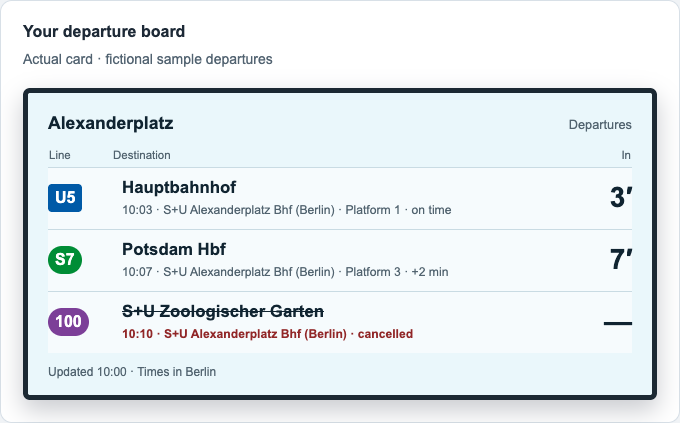
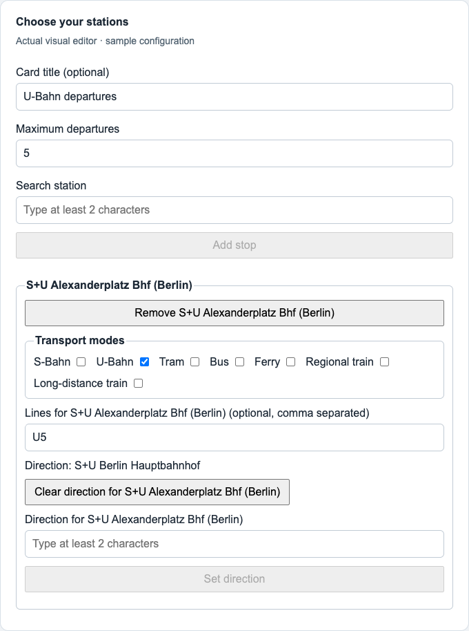

# Transit Board

**Berlin and Brandenburg departures in your Home Assistant sidebar.**

Install the app and add departure cards for the stations and services you want. Give each card its own title, transport modes, lines and direction, with destinations, platforms, delays and cancellations.

*Shared departure-card component rendered with sample data. The app's multi-card controls are not pictured; this is not a screenshot of an installed Home Assistant app.*

## Quick start

Requires a Home Assistant installation with **Supervisor and Apps**, on **amd64** or **aarch64**. The current version is **0.1.0-beta.3**.

Use the button to prefill the repository URL, or follow these steps:

1. Open **Settings → Apps → Install app → ⋮ → Repositories**.
2. Add `https://github.com/arminayat/home-assistant-transit-board`.
3. Find **Transit Board**, install it, and select **Start**.
4. Select **Open Web UI**. Enable **Show in sidebar** for convenient access.
5. Choose **+ Add card**, search for a station, select it, choose **Add stop**, then **Save**.

No API key, YAML, environment variables or dashboard resource is needed. See [Installation](docs/installation.md) for details.

## Make the board yours

Create separate cards for buses, trains or different directions—even at the same station. Each card has a **Settings** gear for its title, stops, filters and departure limit. One inline editor opens at a time; **Save** applies changes and **Cancel** discards the draft. Removing a saved card asks for confirmation, then **Save** applies the removal; **Cancel** restores it.

Everyone who can open the app through Home Assistant shares the household's cards and can edit them. Upgrading from beta 1 preserves your previous board as the first card automatically; reload pages left open during the upgrade.

See the station settings component

*Shared editor component with sample configuration, shown outside Home Assistant.*

The public [BVG REST API](https://v6.bvg.transport.rest/) supplies Berlin and Brandenburg data. Each viewing browser fetches departures while the board is visible; the app creates no Home Assistant entities or background automations. Read about [configuration and privacy](docs/configuration.md).

## Documentation

| Guide | What it covers |
| --- | --- |
| [Installation](docs/installation.md) | App repository, startup, updates and removal |
| [Configuration](docs/configuration.md) | Shared settings, filters, limits and privacy |
| [Troubleshooting](docs/troubleshooting.md) | Ingress, empty boards, failed saves and provider errors |
| [Development](docs/development.md) | Node setup, architecture, dependency updates and release checks |

This is a **beta**. The images demonstrate the shared components with sample data. Browser testing and acceptance inside Home Assistant have not been performed for this app.

## Get involved

See [Support](SUPPORT.md) for questions, [Contributing](CONTRIBUTING.md) for changes, and the [Code of Conduct](CODE_OF_CONDUCT.md) for participation. Report vulnerabilities through the [private security process](SECURITY.md).

[MIT licensed](LICENSE). Attribution and dependency details are in [Third-party notices](THIRD_PARTY_NOTICES.md).
